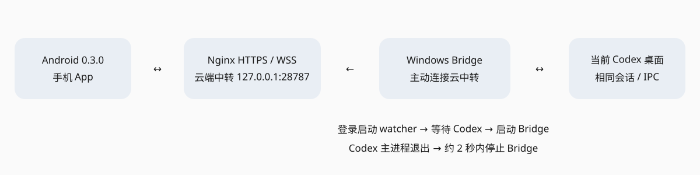

# Codex Remote 云端部署与发布 0.3.0

部署日期：2026-11-06（北京时间）；按每日 10:00 分界的工作纪要归入 20261105。

## 当前可用入口

| 用途 | 地址 |
| --- | --- |
| 手机默认中转 | `wss://daxuechengminiapp.site/codex-remote/ws` |
| 公网健康检查 | https://daxuechengminiapp.site/codex-remote/health |
| 正式签名 APK | https://daxuechengminiapp.site/codex-remote/downloads/codex-remote-0.3.0.apk |
| APK 校验文件 | https://daxuechengminiapp.site/codex-remote/downloads/codex-remote-0.3.0.sha256 |
| 电脑配对控制 | 双击 `E:/Codex/content/secure/remoteapp/Open Codex Remote.cmd` |

电脑控制页仅绑定 `127.0.0.1:18887`，启动入口从受限本地文件读取控制凭据，不在文档中提供带凭据链接。用于刷新配对码、允许/拒绝手机连接与撤销设备授权。新手机先在 App 输入配对码，再在此页确认。

## 云服务器

使用用户附件指定的现有服务器，SSH 优先走已有 NetBird。没有新购资源。中转复用现有 HTTPS 域名的独立 `/codex-remote/` 路径，保留原业务路由。

- 服务：`codex-remote.service`，已 enabled/active，非 root 用户 `codex-relay`。
- 当前代码：`/srv/codex-remote/current` → `/srv/codex-remote/releases/20261106-030`。
- 状态：`/srv/codex-remote/state`，目录 0700、文件 0600，包含电脑认证与设备授权，不对公网提供。
- 中转仅监听 `127.0.0.1:28787`，由已有 Nginx 的有效 TLS 证书终止 WSS；没有公开电脑 IPC/执行端口。
- Nginx 增量配置：`/etc/nginx/codex-remote.locations.conf`；原配置备份：`/srv/codex-remote/backups/nginx-20261106-001331.conf`。
- 公共 APK：`/srv/codex-remote/downloads`，只读下载。发布使用 `.part` 上传、服务器哈希核对后原子替换。
- 运行限制：192 MiB MemoryMax、64 TasksMax、NoNewPrivileges、ProtectSystem=strict、状态目录外只读。

当前实测中转约占 18 MiB 内存。服务会开机自启；WSS 有心跳、过期认证断开、配对尝试限流和设备撤销。二进制数据只经内存转发，不写入命令账本或服务器公开目录。App 内文件下载与日志规则沿用既有版本。

### 磁盘处理记录

部署前系统盘可用空间为 0。先把 `/opt/actions-runner/externals.2.337.0` 完整归档到本机 E 盘，核验归档和 SHA256；保护检查发现一个仍使用 node20 的进程，整目录清理被阻止。最终只清理已备份且没有进程引用的 node24、node20_alpine、node24_alpine 子缓存，并运行 dnf clean all。运行中的 node20、现有服务、数据库与发布数据均保留。

本地可恢复归档：`E:/Codex/content/backups/remoteapp-server-predeploy-20261106/runner-externals-2.337.0.tar.gz`，校验文件同目录 SHA256.txt。部署及 APK 发布后余量约 453 MiB，空间仍紧张，后续构建/发布应先检查容量。

## 本机随 Codex 启停

- 当前用户登录项：`HKCU/Software/Microsoft/Windows/CurrentVersion/Run/CodexRemoteBridge`。
- watcher：`E:/Codex/content/repos/remoteapp/scripts/watch-bridge.ps1`，隐藏运行，每 2 秒检查当前机器真实 Codex 桌面主进程。
- Codex 尚未运行时，watcher 等待；Codex 主进程出现后，启动唯一 Bridge；主进程退出后停止 Bridge。Bridge 自身也检查被绑定的桌面 PID，防止 watcher 意外结束后遗留连接。
- 关闭聊天页面或仅关闭窗口但桌面进程仍在托盘运行，不等于退出 Codex；此时 Bridge 继续运行。
- Bridge 为 `dist/bridge.mjs`，配套 `dist/catalog.py`，不会启动第二个 Codex 进程来接管同一聊天。
- 启动配置：`E:/Codex/content/secure/remoteapp/bridge-launch.json`；状态：仓库 `.state/watcher-status.json`。状态文件记录最近一次状态切换，不作为连续心跳。
- 手工修复登录入口：在仓库运行 `./scripts/install-bridge-startup.ps1`。重新打包 Bridge：`node scripts/bundle.mjs`。启动控制页：`./scripts/open-bridge-control.ps1`。

私有目录和本机状态目录已限制为当前用户与 SYSTEM。服务器登录凭据从原附件本地读取，没有复制进源码、APK 或本工作记录。发布签名密钥保存在 `E:/Codex/content/secure/remoteapp/remoteapp-release.jks`，未来升级必须继续使用此密钥。

## APK 身份

- 包名：`com.remoteapp.mobile`；版本：0.3.0；versionCode：5。
- 独立发布签名，非 Android debug 签名；证书 SHA256：`76111cf6a51a987f3279893a604713b795c62866398106ef8d9a6e0f97b456f8`。
- 文件：`E:/Codex/content/releases/remoteapp/20261106/codex-remote-0.3.0.apk`，34,836,234 字节。
- 文件 SHA256：`592edde5e5848fd2889fb12f166402744331e63d593442bd9d7c7282bfaa5bb4`。
- ARM64-v8a + x86_64，内置 JS，无需 Metro；minSdk 24、targetSdk 36，明文流量关闭；内置真实云端 WSS 地址，不包含电脑/服务器凭据。
- 与旧 `com.remoteapp` 开发包、`com.remoteapp.test` 测试包并存。本次没有再次尝试覆盖旧开发包。

## 实际验收及边界

通过的实际路径：

1. 最终 production APK 在现有 API35 x86_64 模拟器安装启动；核对默认云地址。
2. 电脑控制页在真实 Edge 浏览器引擎中打开，刷新配对码；手机发起请求，控制页点击允许连接，授权设备数从 1 到 2。截图已遮蔽配对码。
3. 手机通过公网 WSS 打开电脑已有测试聊天 `01a1abe9-85da-7751-99d3-9c1aae69f3b8`，发送后收到 CLOUD_RELEASE_OK。
4. 运行中追加要求，最终输出 CLOUD_STEER_OK；再次发起等待任务并从手机停止，桌面 read_thread 确认同一 ID 的状态 interrupted。均使用专用测试数据。
5. 输入 CLOUD_DRAFT_RECONNECT，通过 App 的“重新连接”恢复云端会话，草稿保留；桌面读取确认消息没有重复执行。验证后已清空专用草稿。
6. 外网下载整个最终 APK，与本地及服务器源 SHA256 一致；APK v2 签名、包名、版本、ABI/内置 JS 核查通过。
7. 公网云中转健康检查 bridgeOnline:true；Nginx 配置检测通过，原业务网关和 API live 检查仍为正常，原服务 active。云中转 enabled/active。
8. 本机 watcher 在真实 Codex 正在运行时已启动 Bridge 并接通云端；使用专用可终止进程作为桌面 PID 替身，验证同一 watcher 的启动→被跟踪进程退出→Bridge 停止→等待状态。替身测试不是实际关闭 Codex 验收。

自动检查：19 项协议、文件、并发加载、中转、电脑控制页安全测试通过，根与手机 TypeScript 检查通过；production 构建及签名检查通过。

未验证项与原因：

- 真实退出当前 Codex 再重开的完整联动：关闭它会中断本次执行宿主，尚未执行；已完成上面的实际启动与替身退出检查。
- 强停正式 App、重启中转服务的恢复验收：自动审批拒绝整条命令，只返回 blocked by policy，未执行；改用 App 内重新连接完成可执行的恢复路径。
- 独立验收模拟器启动：同样被自动审批拒绝；所有移动端通过结果来自原有模拟器。首次共享只读实例因模拟器限制启动失败，新建独立 AVD 后的启动被拒绝，未把它当成验收环境。
- ARM64 物理手机、真实移动网络、Windows 重启后登录自启、真实审批请求竞争仍未实测；没有可用对应设备/重启当前宿主的验收路径。
- 原有附件上传、推送、完整分页、纯后台不切页加载、多主机等既有未完成项不因本次发布变为已完成，见既有实现记录。

验收过程中曾观察到页面切换，最初怀疑外部操作；用户明确说明无其他操作，因此不把该推断视为结论。已确认验收脚本使用旧标题查找会受真实聊天标题更新影响；改按当前 UI 分步定位后，云端发送/追加/停止/重连均通过，未再次复现自行返回列表，没有宣称找到未复现跳转的产品根因。

证据：仓库 `artifacts/cloud-pairing-control.png`、`cloud-onboarding-empty.png`、`cloud-release-chat.png`、`cloud-reconnect-draft.png` 及构建日志；控制截图中的配对码已遮蔽。

## 回退边界

停止/禁用本服务、删除登录项或恢复 Nginx 原配置均应作为独立维护操作执行，并先确认当前连接。原配置备份和本地旧缓存归档均已保留。本次没有为验收重启整台服务器或当前 Codex，没有改动已有数据库和业务发布版本。
